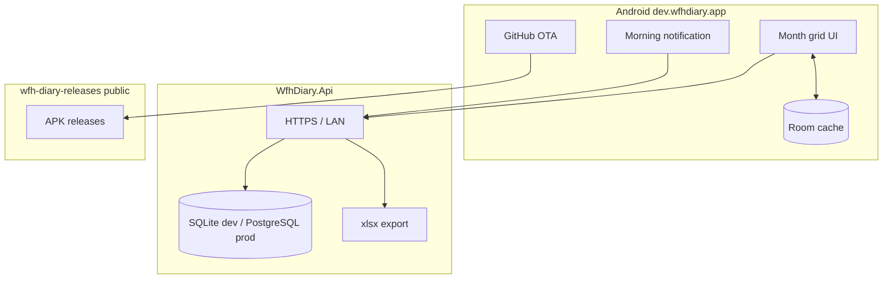

# WFH Diary — architecture

**Last updated:** 2026-06-24 · **Backlog:** [`TODO.md`](TODO.md)

## System context

**Current:** Cloud-primary API; Android syncs via Ktor; Room caches month days. Firebase auth optional (dev uses `X-Debug-User-Id`). Morning WorkManager notification with Home/Office/Leave/Add time actions.

**Reference:** [`platra`](../platra) uses the same auth, CI, and OTA patterns.

## Revision log

- 2026-06-24: Initial architecture — API shipped, Android scaffold + notifications.
