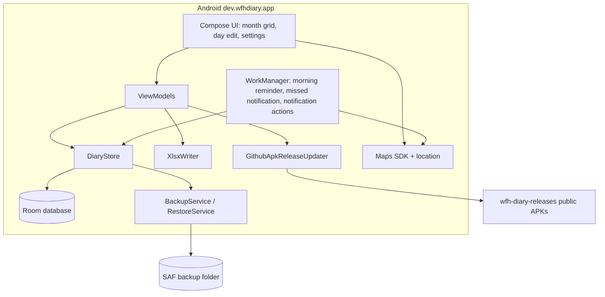

# WFH Diary — architecture

**Last updated:** 2026-10-27 · **Backlog:** [`TODO.md`](TODO.md)

## System context

**On-device only.** The app has no backend and no sign-in. `DiaryStore` (Room: day entries, leave periods, settings) is the single source of truth; UI ViewModels and notification workers read and write through it.

- **Notifications:** `MorningReminderWorker` posts the day-log notification (Home / Office / Leave / Add time). Actions run through `NotificationActionReceiver` → `NotificationActionWorker` and write to `DiaryStore`. If the reminder is ignored, `MissedNotificationWorker` applies the missed-notification default, using the home/office geofences when location is available. If a save fails, the notification is replaced with "Couldn't save entry — open the app to log it" (no retry).
- **Backups:** `BackupService` writes `wfh-diary-backup-YYYY-MM-DD.json` (`BackupDocument`, `format = "wfh-diary-backup"`) to a user-chosen Storage Access Framework folder, scheduled by `BackupScheduler` (daily, plus shortly after each change) with retention via `BackupRetention`. `RestoreService` takes a pre-restore backup before replacing data.
- **Export:** `XlsxWriter` builds the Working from Home Diary spreadsheet on device; `XlsxExportHelper` shares it.
- **Updates:** `GithubApkReleaseUpdater` (Ktor) checks the public `wfh-diary-releases` repo at app start and from Settings, then downloads and installs the APK.
- **Location:** Maps SDK powers **Pick on map** for home/office geofences (`MAPS_API_KEY`); `LocationHelper` and `GeofenceHelper` resolve the current place.

**Reference:** [`platra`](../platra) uses the same CI and OTA patterns.

## Revision log

- 2026-10-27: Rewritten for the on-device app — API, Azure and Firebase removed; Room is the source of truth with file backups.
- 2026-06-24: Initial architecture — API shipped, Android scaffold + notifications.
