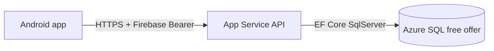

# Azure database plan (WFH Diary API)

Replace **SQLite on App Service local disk** with **Azure SQL Database (free offer)** so diary data survives redeploys and restarts.

**Status:** Phase 1 + Phase 2 done. **Phase 3:** set `WfhDiary__ConnectionString` on App Service, then deploy.

## Why Azure SQL free offer

| Option | Cost | Fit |
|--------|------|-----|
| **Azure SQL Database (free offer)** | $0/month (within limits) | Relational, EF Core, durable — **chosen** |
| PostgreSQL Flexible Server | ~$12–15 USD/mo | Already wired in code, but not free |
| Cosmos DB free tier | $0 | NoSQL — wrong shape for this app |
| SQLite on Azure Files | ~$1/mo storage | Minimal code change, not a managed DB |

Free offer limits (per database, lifetime of subscription):

- 100,000 vCore-seconds compute / month (serverless, auto-pause)
- 32 GB data + 32 GB backup
- Up to 10 free databases per subscription

For a personal WFH diary API this is sufficient.

## Current state

- API: `DatabaseProvider` routes `WfhDiary:ConnectionString` → **SqlServer** (`Server=` / `Initial Catalog=`), **Postgres** (`Host=`), or **SQLite** (default).
- Schema: EF migration `InitialCreate`; Azure SQL uses `MigrateAsync()` on startup.
- Azure SQL provisioned: `sql-wfh-diary-dev` / `wfh-diary` (free offer).
- **Phase 3 pending:** set `WfhDiary__ConnectionString` on App Service and deploy.

## Target architecture



## Implementation phases

### Phase 1 — Code (API repo) ✅

1. ~~Add package `Microsoft.EntityFrameworkCore.SqlServer`.~~
2. ~~EF migration `InitialCreate` in `Migrations/` — all tables.~~
3. ~~`DatabaseProvider.cs` routes connection string → SqlServer / Npgsql / SQLite.~~
4. ~~`DatabaseBootstrap`: `MigrateAsync()` for SqlServer & Postgres; SQLite keeps `EnsureCreated` for local dev/tests.~~
5. Tests still pass on SQLite via `WfhDiaryApiFactory`.

### Phase 2 — Azure provisioning ✅

Resource group: `rg-wfh-diary-dev-australiaeast` (existing).

| Resource | Name |
|----------|------|
| SQL server | `sql-wfh-diary-dev` |
| Database | `wfh-diary` (GeneralPurpose serverless, **free offer**) |
| Firewall | `AllowAzureServices` (0.0.0.0), `AllowDevClient` (your public IP) |

Re-run or reproduce: [`scripts/azure/provision-wfh-diary-sql.ps1`](../scripts/azure/provision-wfh-diary-sql.ps1)

Credentials (password, connection string) are in **`azure-logs/sql-wfh-diary-dev-credentials.local.txt`** on your machine — not in git.

Original steps (for reference):

1. Create **Azure SQL logical server** (e.g. `sql-wfh-diary-dev`) in `australiaeast`.
2. Create database **`wfh-diary`** with **Free offer** enabled (portal or CLI).
3. Firewall:
   - Allow **Azure services**
   - Optional: home IP for SSMS / `sqlcmd` debugging
4. Connection string (example):

   ```
   Server=tcp:sql-wfh-diary-dev.database.windows.net,1433;
   Initial Catalog=wfh-diary;
   User ID=wfhadmin;
   Password=<strong-password>;
   Encrypt=True;
   TrustServerCertificate=False;
   Connection Timeout=30;
   ```

5. Store password in **Key Vault** (`kv-wfh-diary-dev`) when ready; reference from App Service managed identity.

### Phase 3 — App Service configuration

The API reads **`WfhDiary:ConnectionString`** from configuration. On App Service, add an **Application setting** (this becomes an environment variable at runtime):

| Setting name | Value |
|--------------|--------|
| `WfhDiary__ConnectionString` | Full ADO.NET connection string from `azure-logs/sql-wfh-diary-dev-credentials.local.txt` |

**Note:** Double underscore (`__`) is ASP.NET Core’s convention for nested config — `WfhDiary__ConnectionString` maps to `WfhDiary:ConnectionString`. You do **not** need a separate “Connection strings” blade entry unless you prefer it; application settings work the same way.

**Local dev:** leave `WfhDiary:ConnectionString` empty in `appsettings.json` → SQLite file. Or set env var / user secrets to point at Azure SQL for testing.

**Do not commit** the connection string to git. Key Vault reference later: `@Microsoft.KeyVault(SecretUri=...)`.

Deploy API (push to `main` or GitHub Actions). On first startup, `MigrateAsync()` creates all tables in Azure SQL.

```powershell
az webapp config appsettings set `
  --resource-group rg-wfh-diary-dev-australiaeast `
  --name app-wfh-diary-api-dev `
  --settings WfhDiary__ConnectionString="Server=tcp:...;..."
```

### Phase 4 — Verification

- [ ] `GET /health`, `GET /v1/version`
- [ ] Sign in on device → settings save
- [ ] Log a day → persists after App Service restart
- [ ] Export XLSX
- [ ] Leave + work templates CRUD

### Phase 5 — Docs & cleanup

- Update `AZURE_DEPLOY.md` — SQL Server free offer as default prod path; Postgres as paid alternative.
- Update `TODO.md` § D — mark done.
- Remove SQLite-on-Azure warning from runbooks once verified.

## Security checklist

- [ ] SQL admin password in Key Vault, not plain text in repo
- [ ] App Service **system-assigned managed identity** → Key Vault Secrets User
- [ ] Firebase `RequireConfigured=true` on prod App Service
- [ ] No `X-Debug-User-Id` in production builds pointed at prod API

## Rollback

- Remove `WfhDiary__ConnectionString` → API falls back to SQLite on disk (ephemeral again).
- SQL database remains for retry.

## Estimated effort

| Task | Time |
|------|------|
| EF migration + Program.cs + bootstrap | ~2–3 hours |
| Azure SQL provision + app setting | ~30 min |
| Smoke test + doc updates | ~1 hour |

**Total:** half day.

## Open decisions

1. **Key Vault now or connection string in app settings first?** — App settings OK for dev; Key Vault before sharing the app widely.
2. **Keep Npgsql path?** — Yes, harmless; useful if you ever switch to paid Postgres.
3. **Database name** — `wfh-diary` vs `wfh_diary` (either works; pick one and stay consistent).

## References

- [Azure SQL Database free offer](https://learn.microsoft.com/en-us/azure/azure-sql/database/free-offer)
- [`AZURE_DEPLOY.md`](AZURE_DEPLOY.md) — existing App Service setup
- [`Program.cs`](../services/api/WfhDiary.Api/Program.cs) — connection string routing
